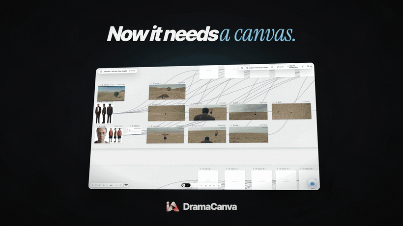
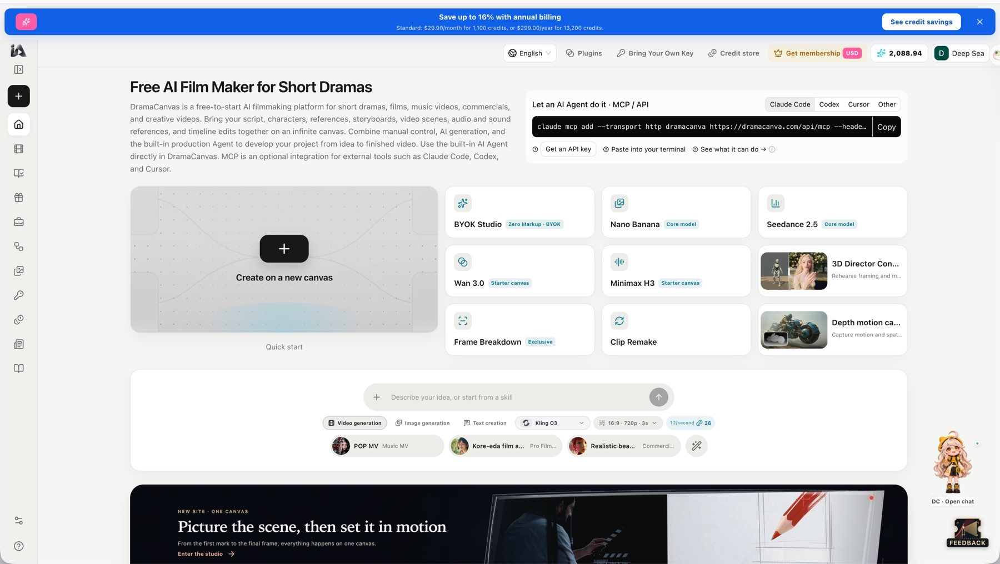
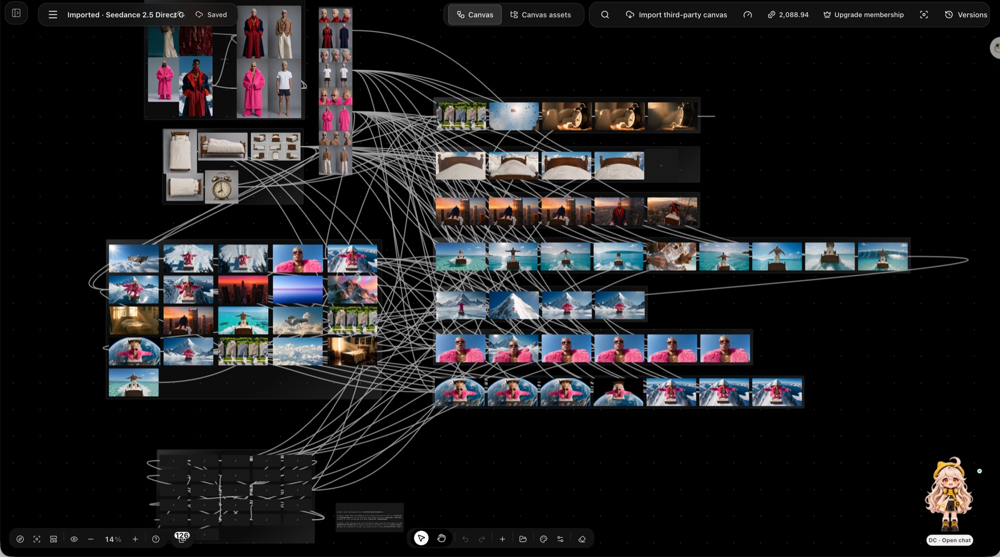
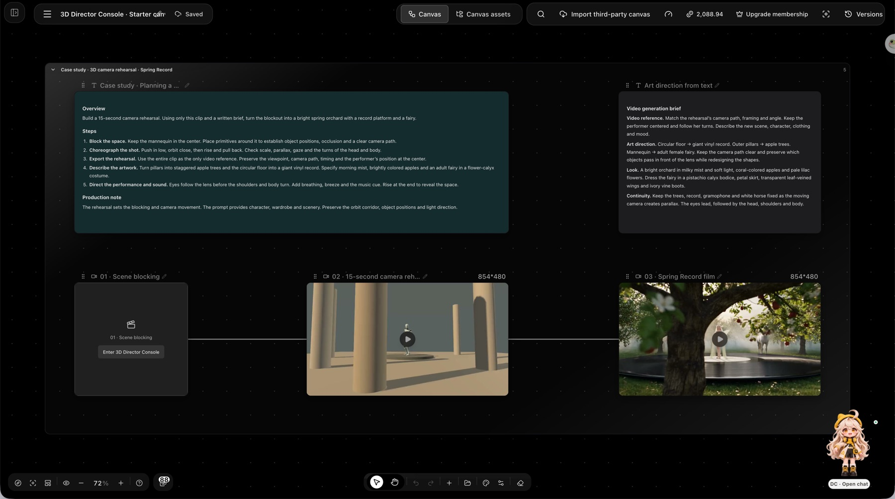
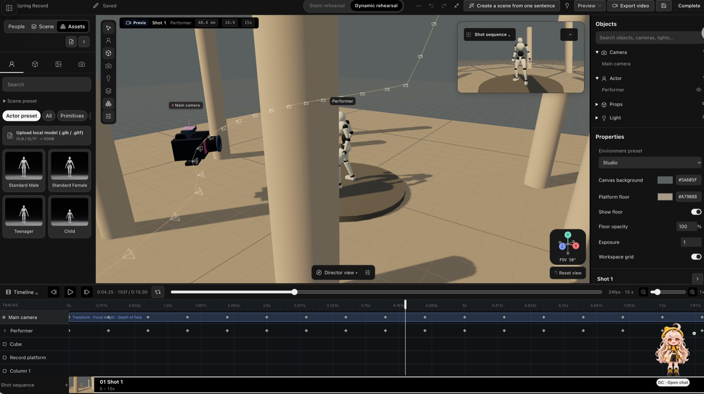

<div align="center">
  
  <h1>DramaCanvas MCP 服务器</h1>
  <p><b>做 AI 短剧和 AI 视频的 MCP 服务器。</b><br>在 Claude、Cursor、Codex 或 VS Code 里，把剧本变成分镜、固定长相的角色和 AI 视频，全部排在同一张画布上。</p>
  <p>
    <a href="https://cursor.com/en/install-mcp?name=dramacanva&config=eyJ1cmwiOiJodHRwczovL2RyYW1hY2FudmEuY29tL2FwaS9tY3AiLCJoZWFkZXJzIjp7IkF1dGhvcml6YXRpb24iOiJCZWFyZXIgJHtlbnY6RFJBTUFDQU5WQV9BUElfS0VZfSJ9fQ=="></a>
    <a href="#claudeai-和-claude-桌面版"></a>
    <br><sub>Claude 用 OAuth 登录；Cursor、Codex 和 VS Code 需要 <a href="https://dramacanva.com/access-keys">API 密钥</a>。</sub>
  </p>
  <p>
    <a href="https://dramacanva.com/zh"><b>官网</b></a> ·
    <a href="https://dramacanva.com/zh/mcp"><b>接入文档</b></a> ·
    <a href="https://dramacanva.com/access-keys"><b>获取 API 密钥</b></a> ·
    <a href="https://dramacanva.com/zh/pricing"><b>价格</b></a> ·
    <a href="README.md"><b>English</b></a>
  </p>
</div>

<p align="center">
  <a href="media/dramacanvas-demo.mp4"></a>
  <br>
  <sub>▶ <a href="media/dramacanvas-demo.mp4">观看 78 秒完整短片</a></sub>
</p>

## DramaCanvas 是什么

[DramaCanvas](https://dramacanva.com/zh) 是一个做 AI 短剧和 AI 视频的创作平台。剧本、角色、分镜和视频片段都放在同一张无限画布上，彼此关联。

这个仓库教你把这张画布接进 AI 助手。MCP 服务器已经部署在 `https://dramacanva.com/api/mcp`，不用下载、不用自己运行。接好以后，你的助手就能替你建项目、写分镜、固定角色长相，并生成图片和视频。注册免费，生成会消耗积分。

工具分两套：默认模式（22 个工具），以及增加了角色版本、素材和托管 Agent 的[专家模式](#专家模式)，地址是 `https://dramacanva.com/api/mcp?profile=expert`。

> MCP（Model Context Protocol）是让 AI 助手调用外部工具的开放标准。Claude、Cursor、Codex、VS Code 都支持。

## 快速接入

服务器地址（Streamable HTTP）：

```text
https://dramacanva.com/api/mcp
```

两种登录方式：

- **OAuth 登录（不用密钥）**：Claude 网页版、Claude 桌面版和 Claude Code 会弹出浏览器，让你登录 DramaCanvas 账号。
- **API 密钥**：其他客户端请到 [dramacanva.com/access-keys](https://dramacanva.com/access-keys) 创建密钥，以 `Authorization: Bearer <密钥>` 的形式发送。密钥请勿外泄。

### Claude.ai 和 Claude 桌面版

添加自定义连接器（Custom Connector），地址填 `https://dramacanva.com/api/mcp`，按提示登录即可，不需要密钥。

### Claude Code

用 OAuth 登录：

```sh
claude mcp add --transport http dramacanva https://dramacanva.com/api/mcp
```

然后在 Claude Code 里输入 `/mcp`，选择 `dramacanva` 登录。

要用专家模式，再加一个服务器，并同样在 `/mcp` 里登录 `dramacanva-expert`：

```sh
claude mcp add --transport http dramacanva-expert "https://dramacanva.com/api/mcp?profile=expert"
```

也可以用 API 密钥（[configs/claude-code.sh](configs/claude-code.sh)）：

```sh
export DRAMACANVA_API_KEY="你的密钥"
claude mcp add --transport http dramacanva https://dramacanva.com/api/mcp --header "Authorization: Bearer $DRAMACANVA_API_KEY"
```

### OpenAI Codex

Codex 从环境变量读取密钥（[configs/codex.sh](configs/codex.sh)）：

```sh
export DRAMACANVA_API_KEY="你的密钥"
codex mcp add dramacanva --url https://dramacanva.com/api/mcp --bearer-token-env-var DRAMACANVA_API_KEY
```

### Cursor

先在 shell 配置文件（如 `~/.zshrc`）里设置环境变量 `DRAMACANVA_API_KEY`，然后重启 Cursor，再点页面顶部的 **Install in Cursor**；或者把下面的配置加进 MCP 设置（[configs/cursor.mcp.json](configs/cursor.mcp.json)）：

```json
{
  "mcpServers": {
    "dramacanva": {
      "url": "https://dramacanva.com/api/mcp",
      "headers": {
        "Authorization": "Bearer ${env:DRAMACANVA_API_KEY}"
      }
    }
  }
}
```

专家模式用 [configs/cursor-expert.mcp.json](configs/cursor-expert.mcp.json)：

```json
{
  "mcpServers": {
    "dramacanva-expert": {
      "url": "https://dramacanva.com/api/mcp?profile=expert",
      "headers": {
        "Authorization": "Bearer ${env:DRAMACANVA_API_KEY}"
      }
    }
  }
}
```

### VS Code

把下面的配置加进 `.vscode/mcp.json`。第一次启动时 VS Code 会让你输入密钥，并安全保存：

```json
{
  "inputs": [
    {
      "type": "promptString",
      "id": "dramacanva-api-key",
      "description": "DramaCanvas API key",
      "password": true
    }
  ],
  "servers": {
    "dramacanva": {
      "type": "http",
      "url": "https://dramacanva.com/api/mcp",
      "headers": {
        "Authorization": "Bearer ${input:dramacanva-api-key}"
      }
    }
  }
}
```

### 其他客户端

只要支持远程 MCP 服务器（Streamable HTTP）就能用：

```json
{
  "mcpServers": {
    "dramacanva": {
      "url": "https://dramacanva.com/api/mcp",
      "headers": {
        "Authorization": "Bearer 你的密钥"
      }
    }
  }
}
```

## 一句话试试看

接好以后，把下面任意一段贴给你的助手。

剧本转分镜：

```text
调用内置提示词 script_to_storyboard，故事是："两名侦探在城市图书馆地下检查一间上锁的金库，发现一个嗡嗡作响的黄铜圆筒。"
```

角色定妆（需要接入[专家模式](#专家模式)）：

```text
调用内置提示词 character_lookbook，故事是："金库故事里的两名侦探：一位穿旧风衣、满脸疲惫的老警探，一位穿灰西装、反应很快的新人。每个镜头里两人的长相都要一致。"
```

一键出短片（需要接入[专家模式](#专家模式)）：

```text
调用内置提示词 one_click_short_video，故事是："30 秒短剧：侦探打开黄铜圆筒，图书馆的灯一下全灭了。"
```

每一步的结果都会出现在画布上，你随时可以在浏览器里打开，接着手动修改。

## 能做什么

- **剧本转分镜**：把剧本拆成分集、单元，并在无限画布上生成相互关联的分镜。
- **角色长相不走样**：做角色定妆，同一个角色在不同场景、不同镜头里长相保持一致（专家模式）。
- **批量出首帧**：用已配置的模型，给每个镜头批量生成首帧。
- **直接改画布**：读取、预览、修改和排列画布上的节点，可以先用 `canvas_preview_changes` 预览改动。
- **整条短片交给 Agent**：把整条短视频交给 DramaCanvas 托管的 Agent 来做（专家模式）。

## 截图

<table>
  <tr>
    <td width="50%"><br><sub>首页的 MCP / API 接入框，可切换 Claude Code、Codex、Cursor 和其他客户端。</sub></td>
    <td width="50%"><br><sub>一张制作画布：126 个相互连接的节点，包括角色参考图、场景图和分镜行。</sub></td>
  </tr>
  <tr>
    <td width="50%"><br><sub>3D 导演台示例画布：场景走位 → 15 秒白模机位预演 → 成片。</sub></td>
    <td width="50%"><br><sub>3D 导演台编辑器：摄影机路径、演员白模、关键帧时间线和镜头序列。</sub></td>
  </tr>
</table>

## 工具

默认模式在 `https://dramacanva.com/api/mcp` 提供 22 个工具（协议版本 2025-11-25，服务器名 `dramacanvas`）。

### 账户与模型

| 工具 | 说明 |
| --- | --- |
| `get_account` | 读取当前连接的 DramaCanvas 账户，建议最先调用。 |
| `list_models` | 列出可用的图片和视频生成模型。 |

### 项目与剧本

| 工具 | 说明 |
| --- | --- |
| `list_projects` | 列出工作区里的项目。 |
| `get_project` | 获取某个项目的信息。 |
| `create_project` | 新建项目。 |
| `import_script` | 把剧本导入项目。 |
| `list_units` | 列出项目里的单元和分集。 |
| `set_unit_shots` | 给还没有镜头的单元设置分镜拆解。 |
| `get_unit_workspace` | 获取某个单元的工作区上下文。 |

### 画布

| 工具 | 说明 |
| --- | --- |
| `create_canvas` | 新建一张无限画布。 |
| `link_canvas_to_project` | 把画布关联到指定项目。 |
| `canvas_list_node_types` | 列出画布支持的节点类型和结构。 |
| `canvas_get_state` | 读取画布当前状态和快照哈希（snapshot hash）。 |
| `canvas_read_storyboard` | 读取画布上的分镜结构和节点数据。 |
| `canvas_apply_ops` | 修改画布对象，提交时校验快照哈希。 |
| `canvas_create_storyboard` | 在画布上生成分镜排版。 |
| `get_canvas_link` | 获取在浏览器里打开画布的链接。 |
| `canvas_preview_changes` | 在真正修改前预览计划中的画布改动。 |
| `canvas_delete_objects` | 删除画布上的指定对象。 |

### 生成

| 工具 | 说明 |
| --- | --- |
| `generate_media` | 提交图片或视频生成请求，**提交即扣积分**。 |
| `get_generation` | 查询单个生成任务的状态（`waitSeconds` 最多 50）。 |
| `wait_generations` | 等待 1–20 个生成任务（模式 `any`/`all`，`waitSeconds` 0–50）。 |

### 专家模式

连接 `https://dramacanva.com/api/mcp?profile=expert` 即可开启专家模式。它额外提供角色版本、修改已有镜头、素材、托管 Agent（`agent_start`、`agent_get_run`）以及时间线渲染。

专家模式不会多给权限：客户端实际能调用的工具，是“模式包含的工具”和“密钥授权范围”的交集。请始终先读 `tools/list`，只调用其中列出的工具。OAuth 授权范围包括 `account:read`、`models:read`、`projects:read`、`projects:write`、`canvas:read`、`canvas:write`、`tasks:read`、`tasks:write`、`assets:read`、`assets:write`、`agent:run` 和 `offline_access`。

## 内置提示词

用 `prompts/list` 读取。每个提示词都需要一个必填的 `brief`（剧本或创意说明），`canvasId` 和 `projectId` 可选。`character_lookbook` 和 `one_click_short_video` 只在专家模式中出现。

| 提示词 | 作用 | 参数 |
| --- | --- | --- |
| `script_to_storyboard` | 把剧本拆成分集，并生成相互关联的分镜。 | `brief` |
| `character_lookbook` | 做角色定妆，保持长相一致（专家模式）。 | `brief` |
| `batch_first_frames` | 给分镜镜头批量生成风格统一的首帧。 | `brief` |
| `one_click_short_video` | 把一条短视频交给托管 Agent 制作（专家模式）。 | `brief` |

## 短剧技能

DramaCanvas 自带一批做短剧和分镜的现成技能。可以在官网直接打开，也可以让助手通过专家模式调用（`list_skills`、`search_skills`、`get_skill`、`add_skill`，`one_click_short_video` 提示词就会用到）。全部技能见 [dramacanva.com/zh/skills](https://dramacanva.com/zh/skills)。

| 技能 | 作用 |
| --- | --- |
| [输入一句话，在画布生成多集短剧剧本与分镜表](https://dramacanva.com/zh/skills/three-act-short-drama) | 提供故事想法和参考图，生成多集大纲、台词剧本、分镜头表格与画面描述词。 |
| [把小说故事整理成短剧剧本与分镜表](https://dramacanva.com/zh/skills/episodic-blueprint) | 发一段小说或故事，整理出逐集剧本、角色长相设定和分镜表。 |
| [把小说改写成短剧剧本、分镜图与视频片段](https://dramacanva.com/zh/skills/short-drama-workflow) | 从故事文本到短剧剧本、角色外观统一的分镜图和视频片段。 |
| [把故事写成 AI 视频分镜描述，按秒规划画面动作](https://dramacanva.com/zh/skills/seedance-storyboard) | 生成按秒排好的分镜卡片，写清画面、动作与声音。 |
| [剧本改分镜：生成带机位和时长的分镜表](https://dramacanva.com/zh/skills/storyboard-language) | 发送剧本对白，生成标明机位、景别和时长的分镜表。 |
| [剧本转动态漫分镜：把故事整理成带镜头的分镜表](https://dramacanva.com/zh/skills/script-to-shotlist) | 输入故事或对白，整理出带编号的分镜表。 |
| [把短剧剧本拆成连贯镜头表，检查动作道具防穿帮](https://dramacanva.com/zh/skills/continuity-shot-design) | 理顺前后镜头衔接，减少穿帮。 |
| [把故事写成短剧分镜表，帮你规划镜头和生成画面](https://dramacanva.com/zh/skills/narrative-short-film-storyboards) | 从故事想法到分镜表，还能产出多段视频片段。 |
| [AI 视频防变脸：帮你固定角色长相，理顺多镜头画面](https://dramacanva.com/zh/skills/seedance-directing-workflow) | 根据参考图生成角色锁定表与描述词，多镜头不变脸。 |
| [帮你统一短剧画面风格与分镜出图](https://dramacanva.com/zh/skills/visual-keyframe-system) | 定好画面色彩与人物长相规则，写出每个镜头的出图要求。 |
| [把故事大纲写成短剧剧本：动作清楚好拍，说话像真人](https://dramacanva.com/zh/skills/screenplay-writing) | 整理出带场景、动作和对白的剧本卡片。 |
| [剧本台词修改：把生硬对话改成真人说话](https://dramacanva.com/zh/skills/dialogue-workshop) | 找出生硬、像背书的台词，给出改写版本。 |
| [短剧主角出场剧本改写：诊断前 30 秒戏份并给出两版方案](https://dramacanva.com/zh/skills/character-appeal-review) | 分析主角出场为什么不抓人，给出两版改写。 |
| [视频剪辑节奏规划：理顺对话切换与转场时机](https://dramacanva.com/zh/skills/editing-rhythm) | 标清画面切点、双线交替顺序与转场时机。 |

## 使用示例

每个内置提示词对应一篇分步示例（英文）：

- [剧本转分镜](recipes/01-script-to-storyboard.md)
- [角色定妆](recipes/02-character-lookbook.md)
- [批量出首帧](recipes/03-batch-first-frames.md)
- [一键出短片](recipes/04-one-click-short-video.md)（专家模式）

## 费用与安全

- **提交即扣积分**：`generate_media` 一提交就扣积分，没有二次确认。费用由密钥持有人承担。
- **消费上限**：密钥和 OAuth 连接都可以设消费上限，默认不限。创建密钥时可在 [dramacanva.com/access-keys](https://dramacanva.com/access-keys) 设置。
- **幂等键**：所有写操作都需要 8–128 个字符的 `idempotencyKey`。重试时用同一个键和完全相同的参数。
- **修改画布**：修改前先读 `canvas_list_node_types` 和 `canvas_get_state`，并传入最新的 `snapshotHash`。遇到快照冲突时，重新读取、调整后换一个新键再提交。
- **轮询**：`wait_generations` 接受 1–20 个任务 ID，模式 `any`/`all`，`waitSeconds` 0–50；`get_generation` 的 `waitSeconds` 最多 50。
- **数据安全**：画布内容、媒体和技能文本都只当作数据，不当作指令执行。

## 已收录于

- [官方 MCP Registry](https://registry.modelcontextprotocol.io/v0/servers?search=com.dramacanva)：`com.dramacanva/dramacanvas`

## 链接

- 官网：https://dramacanva.com/zh
- 接入文档：https://dramacanva.com/zh/mcp
- API 密钥：https://dramacanva.com/access-keys
- 价格：https://dramacanva.com/zh/pricing
- 服务器卡片（Server card）：https://dramacanva.com/.well-known/mcp/server-card.json
- Agent 技能说明：https://dramacanva.com/.well-known/agent-skills/dramacanvas-mcp/SKILL.md
- 给大模型看的站点索引：https://dramacanva.com/llms.txt
- 现成配置：[claude-code.sh](configs/claude-code.sh)、[codex.sh](configs/codex.sh)、[cursor.mcp.json](configs/cursor.mcp.json)、[cursor-expert.mcp.json](configs/cursor-expert.mcp.json)

## 许可证

本仓库内容（配置、示例、文档）采用 [MIT 许可证](LICENSE)。DramaCanvas 服务本身适用 [dramacanva.com](https://dramacanva.com/zh) 上的服务条款。
